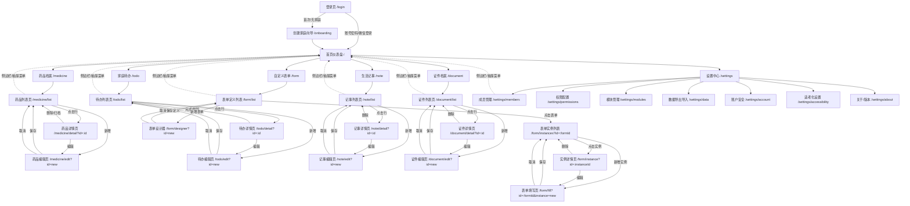
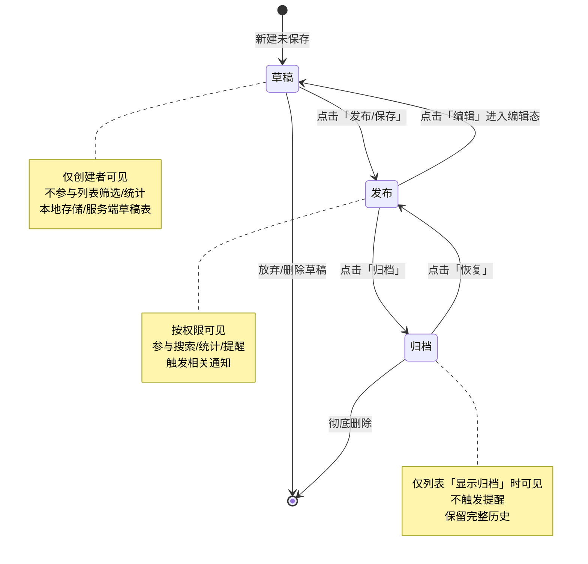
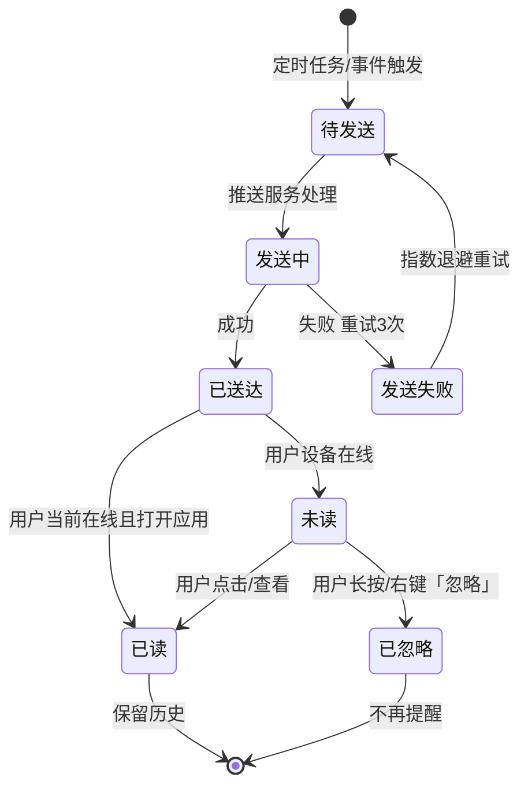
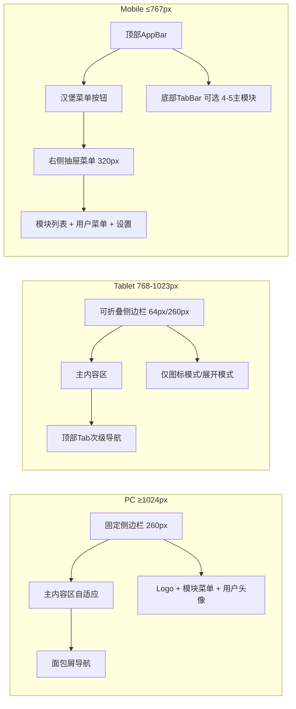

# 家记 - 页面流程图

## 1. 全局页面流向图



---

## 2. 关键任务流详细图

### 2.1 药品录入流程

```mermaid
flowchart TD
    A[首页仪表盘] -->|点击「药品档案」卡片/菜单| B[药品列表页]
    B -->|点击「+ 新增药品」FAB/按钮| C[药品编辑页 - 新建模式]
    
    C --> C1[基础信息区]
    C1 --> C1a[药品名称* | 输入框]
    C1 --> C1b[规格/剂型 | 下拉/输入]
    C1 --> C1c[生产厂家 | 输入框]
    C1 --> C1d[批号/有效期至* | 日期选择器]
    C1 --> C1e[剩余数量* | 数字输入/步进器]
    C1 --> C1f[单位 | 下拉: 盒/瓶/粒/支]
    
    C --> C2[用法用量区]
    C2 --> C2a[用法 | 下拉: 口服/外用/注射/吸入]
    C2 --> C2b[用量 | 输入框: 如 1次2粒]
    C2 --> C2c[频次 | 下拉: 每日1次/2次/3次/按需]
    C2 --> C2d[服用时间 | 多时间选择器]
    
    C --> C3[关联信息区]
    C3 --> C3a[适用成员 | 多选成员头像组]
    C3 --> C3b[适用症状/疾病 | Tag输入]
    C3 --> C3c[购买渠道 | 下拉: 线上/线下医院/药店/其他]
    C3 --> C3d[购买价格 | 数字输入]
    C3 --> C3e[备注 | 多行文本]
    
    C --> C4[图片上传区]
    C4 --> C4a[药品包装照 | 拍照/相册/扫码识别]
    C4 --> C4b[说明书照片 | 多图上传]
    
    C --> C5[操作栏]
    C5 --> C5a[保存草稿 | 暂存本地]
    C5 --> C5b[保存并发布 | 主操作]
    C5 --> C5c[取消 | 返回列表]
    
    C5b -->|校验通过| D[保存成功 Toast + 返回列表]
    C5b -->|校验失败| E[字段级错误提示 + 聚焦首个错误]
    C5a --> F[草稿箱/本地存储]
    C5c -->|有未保存内容| G[离开确认 Modal]
    
    D --> B
    G -->|确定离开| B
    G -->|继续编辑| C
```

### 2.2 待办分配流程

```mermaid
flowchart TD
    A[首页仪表盘] -->|点击「家庭待办」| B[待办列表页]
    B -->|点击「+ 新增待办」| C[待办编辑页]
    
    C --> C1[基本信息]
    C1 --> C1a[标题* | 输入框]
    C1 --> C1b[描述 | 多行文本]
    C1 --> C1c[分类 | 下拉: 家务/采购/医疗/财务/行政/其他]
    
    C --> C2[时间与提醒]
    C2 --> C2a[开始时间 | 日期时间选择器]
    C2 --> C2b[截止时间* | 日期时间选择器]
    C2 --> C2c[全天事件 | 开关]
    C2 --> C2d[重复规则 | 无/每日/每周/每月/自定义Cron]
    C2 --> C2e[提前提醒 | 多选: 10分/30分/1小时/1天/自定义]
    
    C --> C3[分配与协作]
    C3 --> C3a[负责人* | 单选成员头像组 必选1人]
    C3 --> C3b[协助人 | 多选成员头像组]
    C3 --> C3c[可见范围 | 家庭全员/仅负责人/指定成员]
    
    C --> C4[关联与附件]
    C4 --> C4a[关联记录 | 可关联药品/证件/记事]
    C4 --> C4b[附件图片 | 多图上传]
    
    C --> C5[操作栏]
    C5 --> C5a[保存为草稿]
    C5 --> C5b[发布待办 | 触发推送给负责人/协助人]
    C5 --> C5c[取消]
    
    C5b -->|成功| D[列表页显示「待办已分配给 xxx」Toast]
    D --> B
```

### 2.3 自定义表单创建流程

```mermaid
flowchart TD
    A[首页仪表盘] -->|点击「自定义表单」| B[表单定义列表页]
    B -->|点击「+ 创建表单」| C[表单设计器 - 空白画布]
    
    C --> C1[表单元信息]
    C1 --> C1a[表单名称* | 输入框]
    C1 --> C1b[表单别名/Code* | 英文标识 用于API]
    C1 --> C1c[表单图标 | 图标选择器]
    C1 --> C1d[表单描述 | 多行文本]
    C1 --> C1e[默认可见范围 | 家庭全员/仅管理员/指定成员]
    
    C --> C2[字段设计区 - 拖拽式]
    C2 --> C2a[字段面板: 单行文本/多行文本/数字/单选/多选/日期/时间/日期时间/图片/成员选择/关联记录]
    C2 --> C2b[画布区: 已添加字段列表 可拖拽排序]
    
    C2b --> C3[字段属性配置侧边栏 点击字段展开]
    C3 --> C3a[字段标签*]
    C3 --> C3b[字段Key* | 自动生成可改]
    C3 --> C3c[字段类型 | 只读显示]
    C3 --> C3d[是否必填]
    C3 --> C3e[默认值]
    C3 --> C3f[占位符/帮助文本]
    C3 --> C3g[校验规则 | 正则/最小最大长度/数值范围]
    C3 --> C3h[条件显示 | 依赖字段+值 表达式]
    C3 --> C3i[选项配置 | 单多选专用: 标签/值/颜色/排序]
    
    C --> C4[操作栏]
    C4 --> C4a[预览表单 | 新窗口渲染预览]
    C4 --> C4b[保存草稿]
    C4 --> C4c[发布表单 | 生成实例入口]
    C4 --> C4d[取消]
    
    C4c -->|成功| D[表单定义列表页 状态=已发布]
    D --> E[实例列表页 点击「填写」]
    E --> F[动态表单填写页 按元数据渲染]
    F --> G[提交实例]
    G --> H[实例详情页]
```

### 2.4 导出备份流程

```mermaid
flowchart TD
    A[设置中心] -->|点击「数据导出导入」| B[数据管理页]
    
    B --> B1[导出区域]
    B1 --> B1a[导出范围 | 全量/按模块勾选/按时间范围]
    B1 --> B1b[导出格式 | JSON完整/CSV分表/Excel多Sheet]
    B1 --> B1c[包含图片 | 开关 默认关 会显著增大体积]
    B1 --> B1d[加密导出 | 设置密码 AES-256]
    B1 --> B1e[生成导出文件 | 按钮 显示进度条]
    
    B1e -->|生成中| B1f[进度 Modal: 准备数据 -> 打包压缩 -> 加密 -> 下载就绪]
    B1f -->|完成| B1g[下载按钮 + 文件名: jiaji-export-20240115-143022.zip]
    B1g --> B1h[Toast: 导出完成 已自动下载]
    
    B --> B2[导入区域]
    B2 --> B2a[选择文件 | .zip/.json/.csv]
    B2 --> B2b[解析预览 | 显示将导入的模块/条数/冲突检测]
    B2 --> B2c[冲突策略 | 跳过/覆盖/重命名/询问]
    B2 --> B2d[开始导入 | 按钮 显示进度]
    B2d -->|进行中| B2e[进度 Modal]
    B2e -->|完成| B2f[结果汇总: 成功/失败/跳过 条数]
    
    B --> B3[药品CSV模板专区]
    B3 --> B3a[下载标准模板 | medicine-template.csv]
    B3 --> B3b[上传CSV文件 | 拖拽/点击选择]
    B3b --> B3c[预览解析行数/表头映射]
    B3c --> B3d[字段映射确认 | 自动匹配可手动调整]
    B3d --> B3e[导入预检 | 重复批号检测/必填缺失/格式错误]
    B3e --> B3f[确认导入]
```

### 2.5 成员邀请流程

```mermaid
flowchart TD
    A[设置中心] -->|点击「成员管理」| B[成员列表页]
    B -->|点击「+ 邀请成员」| C[邀请成员抽屉/弹窗]
    
    C --> C1[邀请方式]
    C1 --> C1a[微信分享邀请链接 | 生成带参数二维码/链接]
    C1 --> C1b[手机号邀请 | 输入手机号 发送短信/应用内通知]
    C1 --> C1c[面对面扫码 | 显示二维码 被邀请人扫码加入]
    
    C --> C2[预设角色]
    C2 --> C2a[管理员 | 完全控制权]
    C2 --> C2b[可编辑成员 | 增删改查业务数据]
    C2 --> C2c[只读成员/长辈 | 仅查看 可开启适老模式]
    C2 --> C2d[儿童账号 | 仅查看 无管理入口]
    
    C --> C3[邀请有效期 | 默认7天 可选1/3/7/30天/永久]
    C --> C4[备注信息 | 选填 会显示在邀请消息中]
    C --> C5[发送邀请]
    
    C5 --> D[邀请记录列表 状态: 待接受/已接受/已过期/已撤销]
    D -->|被邀请人点击链接| E[注册/登录页 自动绑定家庭]
    E -->|首次登录| F[角色生效 引导完成]
```

---

## 3. 页面层级结构表

| 层级 | 路由路径 | 页面名称 | 布局类型 | 权限要求 | 备注 |
|------|----------|----------|----------|----------|------|
| L0 | `/login` | 登录页 | 空白布局 | 公开 | PWA安装引导 |
| L0 | `/onboarding` | 创建家庭向导 | 空白布局 | 已登录无家庭 | 仅首次 |
| L1 | `/` | 首页仪表盘 | 主布局(侧边栏/抽屉) | 家庭成员 | 核心入口 |
| L2 | `/medicine` | 药品档案首页 | 主布局 | 可读权限 | 重定向到列表 |
| L2 | `/medicine/list` | 药品列表 | 主布局 | 可读权限 | 搜索/筛选/分页 |
| L2 | `/medicine/detail/:id` | 药品详情 | 主布局 | 可读权限 | 含操作栏 |
| L2 | `/medicine/edit/:id?` | 药品编辑 | 主布局 | 编辑权限 | 新建/编辑同页 |
| L2 | `/todo` | 家庭待办首页 | 主布局 | 可读权限 | 重定向到列表 |
| L2 | `/todo/list` | 待办列表 | 主布局 | 可读权限 | 看板/列表切换 |
| L2 | `/todo/detail/:id` | 待办详情 | 主布局 | 可读权限 | 含完成/编辑 |
| L2 | `/todo/edit/:id?` | 待办编辑 | 主布局 | 编辑权限 | 分配逻辑 |
| L2 | `/note` | 生活记事首页 | 主布局 | 可读权限 | 重定向到列表 |
| L2 | `/note/list` | 记事列表 | 主布局 | 可读权限 | 相册/时间轴视图 |
| L2 | `/note/detail/:id` | 记事详情 | 主布局 | 可读权限 | 图片画廊 |
| L2 | `/note/edit/:id?` | 记事编辑 | 主布局 | 编辑权限 | 富文本/图片 |
| L2 | `/document` | 证件档案首页 | 主布局 | 可读权限 | 重定向到列表 |
| L2 | `/document/list` | 证件列表 | 主布局 | 可读权限 | 私密字段脱敏 |
| L2 | `/document/detail/:id` | 证件详情 | 主布局 | 可读/管理员 | 私密字段权限控制 |
| L2 | `/document/edit/:id?` | 证件编辑 | 主布局 | 编辑权限 | 私密字段标记 |
| L2 | `/form` | 自定义表单首页 | 主布局 | 可读权限 | 重定向到列表 |
| L2 | `/form/list` | 表单定义列表 | 主布局 | 可读权限 | 状态标签 |
| L2 | `/form/designer/:id?` | 表单设计器 | 主布局 | 管理员 | 拖拽设计 |
| L2 | `/form/instances/:formId` | 表单实例列表 | 主布局 | 可读权限 | 按表单分组 |
| L2 | `/form/fill/:formId/:instanceId?` | 表单填写页 | 主布局 | 编辑权限 | 动态渲染 |
| L2 | `/form/instance/:instanceId` | 实例详情 | 主布局 | 可读权限 | 只读渲染 |
| L2 | `/settings` | 设置中心首页 | 主布局 | 管理员 | 重定向到成员 |
| L2 | `/settings/members` | 成员管理 | 主布局 | 管理员 | 邀请/角色/移除 |
| L2 | `/settings/permissions` | 权限矩阵 | 主布局 | 管理员 | 模块x角色表格 |
| L2 | `/settings/modules` | 模块管理 | 主布局 | 管理员 | 开关/排序/别名 |
| L2 | `/settings/data` | 数据导出导入 | 主布局 | 管理员 | 含药品CSV模板 |
| L2 | `/settings/account` | 账户安全 | 主布局 | 登录用户 | 密码/2FA/设备 |
| L2 | `/settings/accessibility` | 适老化设置 | 主布局 | 登录用户 | 大字/大按钮开关 |
| L2 | `/settings/about` | 关于版本 | 主布局 | 登录用户 | 版本/协议/反馈 |
```

---

## 4. 状态机定义

### 4.1 记录状态机



### 4.2 提醒/通知状态机



---

## 5. 响应式断点下的导航差异



---

*文档版本：v1.0 | 更新：2024-01 | 维护：UX设计师*